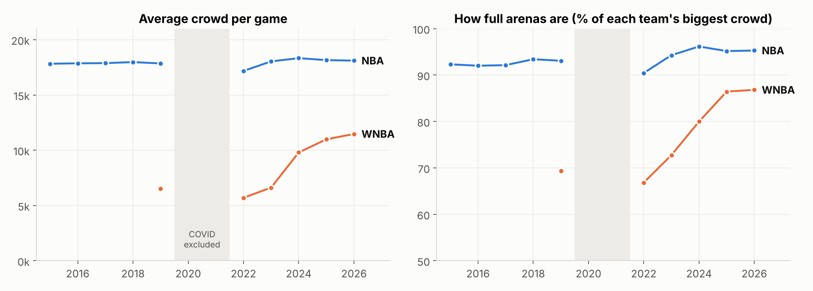
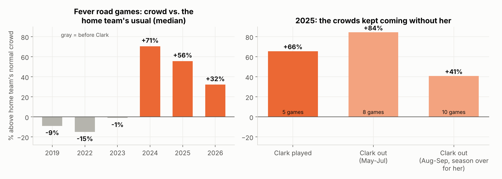
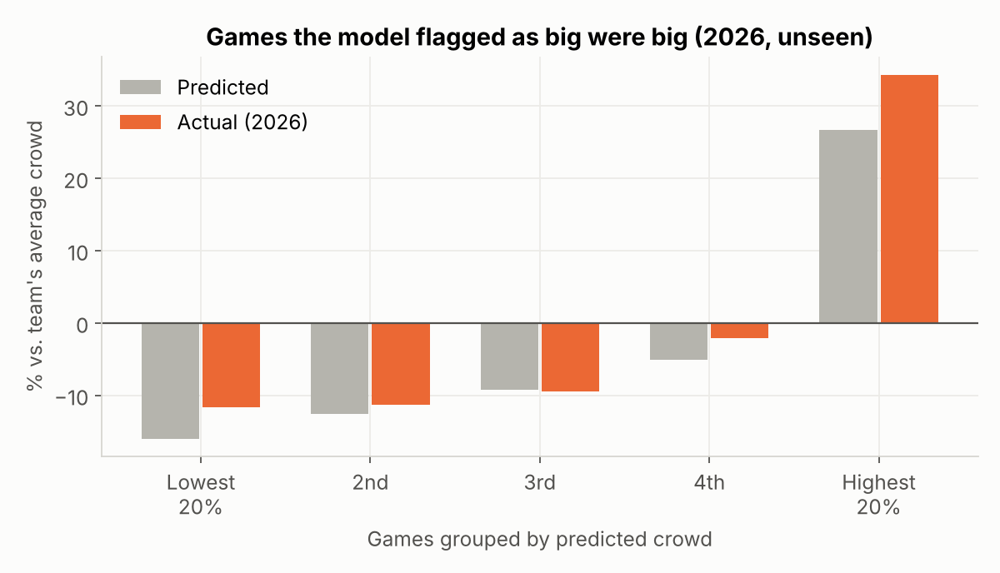

# Selling Growth vs. Selling Scarcity: WNBA & NBA Fan Demand (2015–2026)

**Chaz Colucci** · Sport Management, NC State · SQL · Python · Statistics

What's actually driving the WNBA attendance boom? How does it compare with the NBA? And what should a brand do about it? This project analyzes **1,512 WNBA games and 12,242 NBA games**, tags every game Caitlin Clark played in or missed, and turns the results into a sponsorship pitch for a beverage brand.

## Key findings

| # | Finding | Evidence |
|---|---|---|
| 1 | **The NBA sells scarcity.** Crowds are flat at about 18,000 and arenas run about 95% full. | Within the same team, 2015–19 vs 2023–26: median change −0.2% (p = 0.61, 30 teams) |
| 2 | **The WNBA sells growth.** Average crowds rose from 6,617 (2023) to 11,471 (2026), +73%, and arenas went from about 73% to 87% full. | Season averages, 2019–2026 |
| 3 | **The Clark effect became a Fever effect.** Fever road games went from a median −1% vs. the home team's usual crowd (2023) to **+71%** (2024). | Mann–Whitney p = 0.0003 (adjusted 0.0008) |
| 4 | **Demand survived her injury.** In Aug–Sep 2025, when Clark was out for the season, Fever road games still drew a median **+41%**. | Wilcoxon p = 0.002 (adj. 0.003). With vs. without Clark in 2025: not significant (adj. p = 0.45) |
| 5 | **Growth isn't one team.** Games *not* involving Indiana grew in **11 of 11** comparable markets: 6,800 → 10,805 per game (2023 → 2026). | Wilcoxon p = 0.001; replicated on 2026 |
| 6 | **Teams moved Fever games to NBA arenas:** 20 games, averaging 17,931 fans vs. those teams' usual 6,822. | 2024–2026 |
| 7 | Weekend games draw about 7% more in the WNBA (about 3% in the NBA). The WNBA national TV premium (about 3%) is weak evidence. | Team-season fixed-effects regressions |

All 8 hypotheses were written down before testing and corrected together with **Benjamini–Hochberg**. The 2026 season was held out to replicate the results.

## Model: which games will draw the biggest crowds?
I built a two-stage model, trained on 2022–2025 and tested on all 327 games of the unseen 2026 season:

- **Stage 1, team season average:** "same as last season" (error ≈ 872 fans per team) beat a fitted model (≈ 2,836). The league is changing too fast to forecast the season level precisely, so I report that honestly.
- **Stage 2, game vs. the team's average:** inputs known when the schedule comes out (opponent's past road draw, Fever road game, weekend, summer, relocated to a bigger arena, national TV). This cut game-level error from 1,795 to 1,408 fans (−22%) and ranked the season's top-10% crowds with **AUC 0.955**. **25 of the model's top 30 picks (83%) were actual top-10% games**, where a random pick would land 10% of the time.
- Predictions are capped at each arena's largest previously recorded crowd in either league.

## What it means for a sponsor (beverage category)
1. Buy the **growth curve, not one star**: demand held up without Clark, and every market grew.
2. Use the contrast in negotiation: **NBA = scarce, premium-priced inventory; WNBA = growing inventory**. Multi-year deals signed now lock in today's prices against future crowds.
3. **Pick activation nights from the schedule** with the game-level model: Fever road games, big-arena relocations and summer weekends.
4. **Follow expansion:** Golden State has sold out all 43 home games across two seasons, and Portland averaged 14,516 in year one.

## Files
| File | What it is |
|---|---|
| `wnba_nba_fan_demand.ipynb` | Full executed analysis: data checks, tests, model, limitations, and how I used AI |
| `prep.py` | Builds the clean tables from the raw sportsdataverse parquet files |
| `queries.sql` | SQL data checks and first-look summaries |
| `data/` | `wnba_games.csv`, `nba_games.csv`, `attendance.db` (SQLite) |
| `results.json` | Every number quoted here, written by the notebook |
| `tests.csv`, `calibration_2026.csv` | Hypothesis-test table and model calibration |

## How I used AI
An AI assistant (Claude) helped me find the data sources, draft SQL and pandas code, and suggest tests. I verified its work:
- I checked every Clark game tag against box scores; the notebook asserts that every Fever game is tagged.
- I pre-registered the hypotheses, corrected for multiple tests, and held out 2026.
- I rejected an early model that double-counted Clark at already-full Fever home games.
- I rejected machine-learning season forecasts that lost to "same as last year."

## Limitations
- Attendance is team-reported.
- Capacity is a proxy: each team's biggest crowd.
- The TV effect is an association, not a cause.
- Clark-absence samples are small, and tickets bought before injury news shrink the measured gap.
- No ticket-price or sponsorship-revenue data is included.

**Data:** ESPN via [sportsdataverse](https://github.com/sportsdataverse) (`wehoop-wnba-data`, `hoopR-nba-data`). Regular season only. 2020–21 COVID seasons and All-Star games are excluded.
